# 🚀 Awesome Shell Tools & Prompt Managers

  <strong>Curated directory of SaaS terminal platforms, open-source shell frameworks, prompt theme engines, and CLI startup performance optimizers.</strong>

  
  
  
  
  
  

---

## 📑 Table of Contents
- [📌 Overview & SEO Highlights](#-overview--seo-highlights)
- [🌐 Sector Overview & Market Dynamics](#-sector-overview--market-dynamics)
- [💼 Commercial & SaaS Terminal Platforms](#-commercial--saas-terminal-platforms)
- [⚡ Open-Source GitHub Projects (Ranked by Stars)](#-open-source-github-projects-ranked-by-stars)
  - [Top Shell Frameworks & Prompts](#top-shell-frameworks--prompts)
  - [High-Performance Plugin & Autocomplete Ecosystem](#high-performance-plugin--autocomplete-ecosystem)
- [🏎️ Startup Latency & Benchmarks](#️-startup-latency--benchmarks)
- [🛠️ How to Contribute](#️-how-to-contribute)
- [📈 Star History](#-star-history)
- [💖 Support & Community](#-support--community)
- [📄 Disclaimer](#-disclaimer)

---

## 📌 Overview & SEO Highlights

Welcome to the definitive index of **Shell Tools & Prompt Managers**! The modern command-line interface (CLI) is no longer a plain monochrome teletype. Developers, DevOps practitioners, and cloud architects depend on interactive terminal prompts that surface real-time **git status indicators**, **cloud runtime contexts** (AWS, GCP, Kubernetes), **programming language version tags** (Rust, Go, Node.js, Python), **execution durations**, and **error code badges** — all while maintaining sub-millisecond shell startup benchmarks.

Whether you are configuring **Zsh** on macOS, customizing **Bash** on Ubuntu, supercharging **PowerShell** on Windows, or experimenting with **Fish** and **Nushell**, this curated guide provides:
- 📊 **Commercial & SaaS Terminal Suites** evaluated by enterprise scale, upfront pricing tiers, and permanent free quotas.
- ⭐ **Leading Open-Source Prompt Engines & Plugin Managers** sorted strictly by live GitHub stargazers.
- ⏱️ **Cold-Start Performance Discipline** to ensure your shell initialization never degrades your terminal workflow.

---

## 🌐 Sector Overview & Market Dynamics

The global **Developer Productivity & Terminal Shell Tools** sector is valued at an estimated **$16.4 Billion in 2026** (projected to surpass $31.8 Billion by 2032 with a CAGR of ~11.7%), propelled by cloud-native engineering complexity, microservices orchestration, and the integration of AI-assisted command generation directly inside command-line runtimes.

The sector demonstrates a **moderately fragmented** competitive dynamic:
- **Enterprise Hyperscalers** (such as Amazon AWS via Amazon Q Developer / Fig and Microsoft) anchor deep enterprise identity and broad AI developer suites.
- **Specialized Commercial Innovators** (such as Warp and Termius) drive product-led growth (PLG) through GPU-accelerated terminal emulators, team collaboration runbooks, and cloud profile synchronization.
- **Grassroots Open-Source Governance**: Unlike traditional SaaS categories susceptible to winner-take-all capture, shell prompting remains vigorously community-controlled. Millions of engineers daily rely on independent open-source prompt engines (**Starship**, **Powerlevel10k**, **Oh My Zsh**, **Oh My Posh**), establishing a high barrier against closed proprietary lock-in.

---

## 💼 Commercial & SaaS Terminal Platforms

The table below catalogs premier SaaS products and commercial terminal extensions offering prompt management, AI assistance, and team orchestration. Entries are **sorted descending by company scale (valuation / market capitalization / revenue)**.

| 🏢 Product / Platform | 🏢 Organization | 💰 Valuation / Company Scale | 🏷️ Starting Pricing | 🎁 Free Tier Limits | 🎯 Key Prompt & Shell Highlights |
| :--- | :--- | :--- | :--- | :--- | :--- |
| **[Amazon Q Developer](https://aws.amazon.com/q/developer/)** (formerly Fig CLI) | Amazon / AWS | **$2.1 Trillion Market Cap** (AWS >$105B annual run rate) | **$19.00 / user / month** (Pro Tier) | **Free Forever**: Unlimited personal IDE & CLI completions, basic AI inline generations, 25 chat interactions/month | IDE-style autocomplete popups, command doc hints, and contextual prompt flags directly injected into Bash, Zsh, and Fish. |
| **[Warp](https://www.warp.dev/)** | Warp Technologies, Inc. | **~$500 Million Valuation** (~$15M ARR, Series B) | **$20.00 / user / month** ($15/mo billed annually for Team) | **Free Forever**: Full GPU terminal client for individuals, up to 3 team members, 100 Warp AI requests/month, 5 saved workflows | AI-assisted command drafting, block-based terminal output separation, native customizable prompt themes, and cloud-shared team commands. |
| **[Termius](https://www.termius.com/)** | Termius Corporation | **~$100 Million Valuation** (~$12M ARR) | **$10.00 / user / month** ($12/mo billed monthly for Pro) | **Free Forever**: Single-device local terminal, basic SSH/SFTP access, unlimited host storage, 0 cloud-synchronized devices | Cross-platform terminal client with encrypted SSH key vaults, shared shell snippets, custom prompt formatting, and mobile companion apps. |
| **[Wave Terminal](https://www.waveterm.dev/)** | Wave Terminal Inc. | **~$15 Million Valuation** (~$1.2M ARR, Seed) | **$16.00 / user / month** (Wave Team plan) | **Free Forever**: Unlimited local/remote workspace sessions, open-source core, bring-your-own-API-key or 50 free cloud AI prompts | Open-source terminal canvas embedding inline web previews, markdown notes, persistent graphical tabs, and contextual prompt chips. |
| **[iTerm2 Shell Integration](https://iterm2.com/)** | GNCH Software (George Nachman) | **~$150 Thousand ARR** (Community Backed / GitHub Sponsors) | **$0.00 / Community Supported** (Optional $5/mo GitHub sponsorship) | **Free Forever**: 100% features free without restrictions, unlimited sessions, full prompt status marks, and profile presets on macOS | Injects OSC escape sequences to report current directory, exit codes, git branch status markers, and user badges without external daemons. |

---

## ⚡ Open-Source GitHub Projects (Ranked by Stars)

The following open-source frameworks, prompt engines, and plugin orchestrators represent the gold standard of terminal customizability. All projects are **sorted in strictly descending order by live GitHub stargazers**.

### Top Shell Frameworks & Prompts

1. **[Oh My Zsh](https://github.com/ohmyzsh/ohmyzsh)**   
   👑 **The undisputed benchmark in shell configuration frameworks** — MIT licensed. Provides an expansive community-driven ecosystem featuring 300+ bundled plugins and 150+ custom themes. Includes built-in auto-updates, helper functions, and rich alias packs for git, docker, and cloud CLIs. Cold startup can reach 148ms+ with heavy plugins, encouraging curated plugin usage.

2. **[Starship](https://github.com/starship/starship)**   
   🚀 **The ultimate cross-shell prompt champion** — ISC licensed, compiled natively in Rust. Works seamlessly across Bash, Zsh, Fish, PowerShell, Nushell, Ion, and Elvish with a single unified `starship.toml` configuration file. Renders complex git status, language toolchains, AWS/Kube contexts, and command execution timers with sub-10ms latency.

3. **[Powerlevel10k](https://github.com/romkatv/powerlevel10k)**   
   ⚡ **The ultra-fast, feature-dense Zsh prompt engine** — MIT licensed. Renowned for its groundbreaking **Instant Prompt** technology that draws a responsive prompt before Zsh finishes sourcing scripts (~25ms cold start). Includes an interactive graphical setup wizard (`p10k configure`) with full Nerd Font glyph support.

4. **[Zsh Autosuggestions](https://github.com/zsh-users/zsh-autosuggestions)**   
   💡 **Fish-like fast command suggestions for Zsh** — MIT licensed. Asynchronously scans shell history and current completions to suggest commands in muted gray text as you type, pressable with right-arrow or custom keybindings.

5. **[Fish Shell](https://github.com/fish-shell/fish-shell)**   
   🐟 **User-friendly command-line shell with native prompt theming** — GPL-2.0 licensed. Ships out-of-the-box with syntax highlighting, autosuggestions, tab completions, and modular `fish_prompt` functions without requiring third-party frameworks.

6. **[Oh My Posh](https://github.com/JanDeDobbeleer/oh-my-posh)**   
   ✨ **Cross-shell prompt theme engine written in Go** — MIT licensed. The premier prompt theming solution for Windows PowerShell, macOS, and Linux terminals. Features a modular JSON/YAML configuration format, dozens of built-in community presets, and transient prompt rendering.

7. **[Zsh Syntax Highlighting](https://github.com/zsh-users/zsh-syntax-highlighting)**   
   🎨 **Real-time command validation and syntax coloring** — BSD-3-Clause licensed. Highlights commands, flags, arguments, paths, and unclosed quotes directly inside the prompt line before execution.

8. **[Spaceship Prompt](https://github.com/spaceship-prompt/spaceship-prompt)**   
   🛸 **Minimalistic, powerful, and customizable Zsh prompt** — MIT licensed. Features a clean sections-based architecture displaying git branches, Docker containers, Kubernetes contexts, and package manager versions only when pertinent to the active directory.

9. **[Bash-it](https://github.com/Bash-it/bash-it)**   
   🛡️ **Community-driven framework for GNU Bash** — MIT licensed. Brings Oh My Zsh-style aliases, completions, plugins, and custom prompt themes to Bash users across macOS, Linux, and WSL.

10. **[Prezto](https://github.com/sorin-ionescu/prezto)**   
    ⚡ **Instantly responsive, modular configuration framework for Zsh** — MIT licensed. Designed as a lean, high-discipline alternative to Oh My Zsh with strict module loading hygiene, clean sane defaults, and curated prompt themes.

11. **[Pure](https://github.com/sindresorhus/pure)**   
    🌿 **Pretty, minimal, and fast Zsh prompt** — MIT licensed. Pioneers asynchronous git status checks so prompt rendering never stutters when entering massive repositories. Focuses on typographic clarity without visual icon overload.

12. **[Oh My Fish](https://github.com/oh-my-fish/oh-my-fish)**   
    🐠 **The Fish shell framework** — MIT licensed. Provides package management infrastructure for Fish, allowing instant discovery, installation, and auto-loading of third-party themes and shell plugins.

13. **[Antigen](https://github.com/zsh-users/antigen)**   
    📦 **Classic plugin manager for Zsh** — MIT licensed. Inspired by Vim's pathogen, allowing users to declare and load Oh My Zsh bundles, standalone GitHub plugins, and themes via clean `antigen bundle` syntax.

14. **[Zsh Completions](https://github.com/zsh-users/zsh-completions)**   
    ⌨️ **Additional completion definitions for Zsh** — Zsh License. Supplies community-curated tab-completion scripts for hundreds of CLI binaries that do not bundle native shell completions.

15. **[Zplug](https://github.com/zplug/zplug)**   
    🔌 **Next-generation parallel plugin manager for Zsh** — MIT licensed. Capable of managing Oh My Zsh plugins, Prezto modules, GitHub releases, binary executables, and local shell scripts with concurrent git fetching.

16. **[fzf-tab](https://github.com/Aloxaf/fzf-tab)**   
    🔍 **Replace Zsh default completion menu with interactive fzf** — MIT licensed. Converts static shell completion listings into an instant fuzzy-searchable overlay with live directory previews and syntax coloring.

17. **[Zinit](https://github.com/zdharma-continuum/zinit)**   
    🏎️ **Turbo-mode flexible plugin manager for Zsh** — MIT licensed. Renowned for its asynchronous deferred loading (`wait` and `lucid` ice modifiers) that defers heavy plugin evaluation until after the first prompt is displayed.

18. **[Liquidprompt](https://github.com/nojhan/liquidprompt)**   
    💧 **Adaptive, intelligent prompt for Bash and Zsh** — AGPL-3.0 licensed. Dynamically reveals system load averages, battery percentages, detached screen/tmux sessions, and pending jobs only when critical thresholds are exceeded.

19. **[Tide](https://github.com/IlanCosman/tide)**   
    🌊 **Ultimate async prompt engine for Fish shell** — MIT licensed. Delivers a Powerlevel10k-caliber experience to Fish users with an interactive setup wizard (`tide configure`), multi-line layouts, and non-blocking background workers.

20. **[Znap (zsh-snap)](https://github.com/marlonrichert/zsh-snap)**   
    ⚡ **Lightweight, blazing-fast Zsh plugin manager and compiler** — MIT licensed. Automatically byte-compiles your `.zsh` files in the background and caches completion scripts for rapid shell bootstrapping.

21. **[agkozak Zsh Prompt](https://github.com/agkozak/agkozak-zsh-prompt)**   
    🎯 **Asynchronous, portable Zsh prompt** — MIT licensed. Employs async workers to calculate git branch status and virtualenv indicators without sluggish delay, requiring no external dependencies.

---

## 🏎️ Startup Latency & Benchmarks

The startup time of your shell dictates whether opening a new terminal tab feels instantaneous or frustrating. Below are representative cold-start benchmarks across popular configurations:

| ⚙️ Configuration Setup | ⏱️ Average Cold Start Latency | 💡 Performance Notes |
| :--- | :--- | :--- |
| **Bare Zsh (`zsh -f`)** | **~10ms – 15ms** | Raw baseline with zero plugins or themes. |
| **Starship Native Binary** | **~18ms – 25ms** | Compiled Rust binary with cross-shell caching. |
| **Powerlevel10k (Instant Prompt)** | **~20ms – 28ms** | Pre-renders prompt before sourcing plugin definitions. |
| **Zinit (with Turbo Deferred Loading)** | **~35ms – 45ms** | Sinks plugin loading into background event loops. |
| **Prezto (Curated Modules)** | **~60ms – 85ms** | Optimized module loading with minimal overhead. |
| **Oh My Zsh (Default + 6 Plugins)** | **~140ms – 175ms** | Sourcing multiple bash/zsh scripts sequentially. |
| **Unoptimized Setup (20+ Plugins)** | **~450ms – 900ms+** | Noticeable lag on every new terminal split or tab. |

> [!TIP]
> **Performance Recommendation**: Profile your shell startup anytime with `time zsh -i -c exit` or `zsh -xv` to isolate slow-sourcing plugin dependencies!

---

## 🛠️ How to Contribute

We welcome additions, corrections, and benchmark submissions from the terminal community!

1. 🍴 **Fork the repository** on GitHub.
2. 🌿 **Create a descriptive feature branch** (`git checkout -b add-my-prompt-tool`).
3. 📝 **Add your entry** under the appropriate SaaS or Open-Source category:
   - Provide the product/project name, official link, stargazers badge (if open-source), and an objective technical summary.
   - For SaaS tools, specify precise tier pricing and explicit free tier limits.
4. 🧪 **Ensure all links are valid** and the formatting matches the existing document.
5. 🚀 **Submit a Pull Request** with a concise explanation of your enhancement.

---

## 📈 Star History

---

## 💖 Support & Community

Thank you for visiting **Awesome Shell Tools & Prompt Managers**! If this curated guide helps you craft a faster, more productive command-line environment:

- ⭐ **Star this repository** on GitHub to keep it visible and help others discover top terminal tools.
- 🍴 **Fork and share** the repo with your developer communities, teams, and colleagues.
- 💬 **Join the conversation** on [Discord](https://discord.gg/jc4xtF58Ve) and connect with other CLI enthusiasts.
- ☕ **Support Ongoing Maintenance**: Back future updates and open-source curation via the [GitHub Sponsor Dashboard](https://github.com/sponsors/ishandutta2007).

---

## 📄 Disclaimer

- This repository is a community-curated technical directory provided for informational and educational purposes. Inclusion does not constitute an official endorsement.
- All product names, logos, and brands are property of their respective owners.
- Prompt theme performance varies depending on terminal emulators, OS font rendering, storage disk speeds, and active git repository sizes. Always test in your local environment.

---

  Maintained with ❤️ by <a href="https://github.com/ishandutta2007">Ishan Dutta</a> and the global open-source community.

